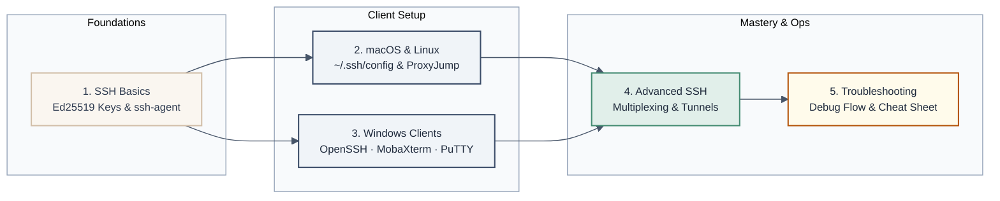

# SSH Learnings


A comprehensive, cross-platform reference and learning guide for **Secure Shell (SSH)** — designed to take you from your very first key pair to jump hosts, port forwarding, connection multiplexing, and Windows tooling.

> [!NOTE]
> Every guide renders natively on **GitHub** (including interactive Mermaid diagrams and callouts) and publishes as a custom-themed, light/dark **GitHub Pages** site from `/docs`.

---

## Learning Path



---

## Table of Contents

| # | Guide | Audience | Highlights |
|---|-------|----------|------------|
| 1 | [SSH Basics](docs/01-ssh-basics.md) | Novice | Public-key auth sequence diagram, `ed25519` keys, `ssh-copy-id`, `ssh-agent`, and permissions. |
| 2 | [Client Configuration (macOS & Linux)](docs/02-client-configuration.md) | Novice → Intermediate | `~/.ssh/config` rules, cross-platform `Host *` defaults, multiple identities, and `ProxyJump` architecture. |
| 3 | [Windows SSH Clients](docs/03-windows-clients.md) | Novice → Intermediate | Client decision tree + full setup for **Native OpenSSH**, **MobaXterm**, and **PuTTY / Pageant / Plink**. |
| 4 | [Advanced SSH Techniques](docs/04-advanced-ssh.md) | Advanced | Multiplexing & tunneling diagrams (`-L`, `-R`, `-D`), `scp`/`rsync`, `Include`/`Match`, FIDO2 keys, and escape sequences. |
| 5 | [Troubleshooting & Cheat Sheet](docs/05-troubleshooting-and-cheatsheet.md) | All Levels | Visual debugging decision tree (`ssh -vvv`), common error fixes, and quick-reference tables. |

---

## Viewing as a Website (GitHub Pages)

This repository includes a custom responsive Jekyll layout ([docs/_layouts/default.html](docs/_layouts/default.html)), Muted Shibui light/dark theme ([docs/assets/css/style.css](docs/assets/css/style.css)), and automatic Mermaid + callout rendering ([docs/assets/js/enhancements.js](docs/assets/js/enhancements.js)):

1. Open your repository on GitHub and go to **Settings → Pages**.
2. Under **Build and deployment**, set **Source** to **Deploy from a branch**.
3. Select your default branch (`trunk`) and the **`/docs`** folder, then click **Save**.
4. GitHub will build and publish the site automatically.

## Running Local Validation Tests

Verify Markdown links, Mermaid diagram standards, theme invariants, and client-side enhancements using Node's built-in test runner (Node 20+):

```bash
npm test
```
