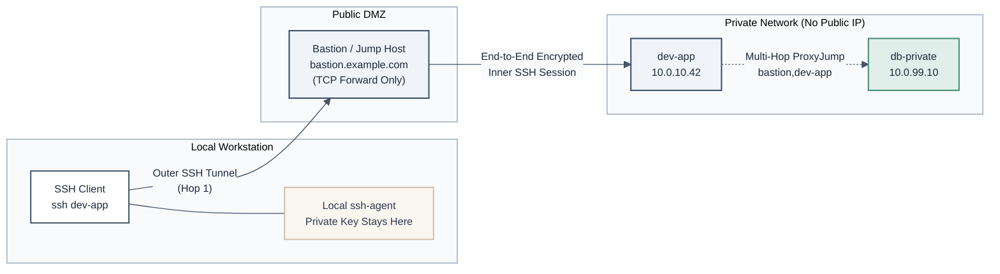

# 2. Client Configuration (macOS & Linux)

**Guide 2 of 5** · [← SSH Basics](./01-ssh-basics.md) · [Home](./index.md) · [Next: Windows SSH Clients →](./03-windows-clients.md)

---

## Why Use `~/.ssh/config`?

Instead of typing long commands like:

```bash
ssh -i ~/.ssh/id_ed25519_work -J alice@bastion.example.com -p 2222 alice@10.0.1.50
```

You can define reusable profiles in `~/.ssh/config` and simply run:

```bash
ssh app-prod
```

Every OpenSSH tool (`ssh`, `scp`, `sftp`, `rsync`, `git`) automatically reads `~/.ssh/config`.

---

## How OpenSSH Evaluates `~/.ssh/config`

> [!IMPORTANT]
> **First-match wins!** For any given setting (such as `User` or `IdentityFile`), OpenSSH uses the **first** value it encounters from top to bottom.
> Always place **specific `Host` blocks at the top** and your **global `Host *` defaults at the bottom** of the file.

---

## Creating the Config File

```bash
mkdir -p ~/.ssh
touch ~/.ssh/config
chmod 700 ~/.ssh
chmod 600 ~/.ssh/config
```

Open it in your preferred editor (`nano ~/.ssh/config`, `vim ~/.ssh/config`, or `code ~/.ssh/config`).

---

## Cross-Platform Global Defaults (`Host *`)

Place a `Host *` block at the **bottom** of `~/.ssh/config` to apply safe defaults to all connections:

```sshconfig
Host *
    # Automatically add keys to ssh-agent on first use
    AddKeysToAgent yes

    # macOS Keychain support (IgnoreUnknown prevents errors on Linux)
    IgnoreUnknown UseKeychain
    UseKeychain yes

    # Only use the IdentityFile specified for a host (prevents "Too many authentication failures")
    IdentitiesOnly yes

    # Keep idle connections alive (sends a keepalive every 60s, disconnects after 3 missed)
    ServerAliveInterval 60
    ServerAliveCountMax 3
```

> [!NOTE]
> **Why `IgnoreUnknown UseKeychain`?** `UseKeychain` is an Apple-specific OpenSSH option. Without `IgnoreUnknown UseKeychain` above it, sharing the same `~/.ssh/config` on a Linux machine causes SSH to fail with `Bad configuration option: usekeychain`.

---

## Defining Host Aliases & Multiple Identities

You can assign different usernames, ports, and keys per host — especially useful when separating personal and work accounts:

```sshconfig
# Personal GitHub
Host github.com
    HostName github.com
    User git
    IdentityFile ~/.ssh/id_ed25519_personal

# Work GitHub (use: git clone git@github-work:org/repo.git)
Host github-work
    HostName github.com
    User git
    IdentityFile ~/.ssh/id_ed25519_work

# Standard Linux server
Host web01
    HostName 203.0.113.25
    User deploy
    Port 2222
    IdentityFile ~/.ssh/id_ed25519_work
```

Now `ssh web01` connects to `deploy@203.0.113.25` on port `2222` using your work key.

---

## Jump Hosts / Bastion Servers (`ProxyJump`)

In many environments, internal servers are not directly reachable from the internet. You must first connect through a **jump host** (also called a **bastion host**).

Modern OpenSSH (7.3+) provides **`ProxyJump`**, which is cleaner and far more secure than agent forwarding because your private key never leaves your local machine and the bastion never sees your decrypted inner session.



### Single-Hop Jump Host

```sshconfig
# 1. Define the jump / bastion server
Host bastion
    HostName bastion.example.com
    User <username>
    IdentityFile ~/.ssh/id_ed25519_work

# 2. Define the internal destination server using ProxyJump
Host dev-app
    HostName 10.0.10.42
    User <username>
    IdentityFile ~/.ssh/id_ed25519_work
    ProxyJump bastion
```

Connect directly to the internal server with:

```bash
ssh dev-app
```

OpenSSH transparently establishes the connection through `bastion` to `10.0.10.42`.

### Multi-Hop Jump Hosts

You can chain multiple jump hosts separated by commas:

```sshconfig
Host db-private
    HostName 10.0.99.10
    User dbadmin
    ProxyJump bastion,dev-app
```

### Ad-Hoc Jump Host from the Command Line (`-J`)

You don't even need a config entry for a one-off jump:

```bash
ssh -J <username>@bastion.example.com <username>@10.0.10.42
```

---

## Security Note: Avoid Global `ForwardAgent yes`

> [!WARNING]
> **Never put `ForwardAgent yes` in `Host *`.**
> Agent forwarding exposes your local `ssh-agent` socket on the remote server. Anyone with `root` access on that remote server can use your forwarded agent to authenticate as you to *other* servers while you are connected.

- **Prefer `ProxyJump`** for reaching internal servers — it does not expose your agent to the jump host.
- If you genuinely need agent forwarding (e.g., running `git pull` on a trusted dev box), enable it **only on that specific host**:

```sshconfig
Host trusted-dev-box
    HostName dev.internal.example.com
    User <username>
    ForwardAgent yes
```

---

## Complete Example `~/.ssh/config`

```sshconfig
# --- Jump Host ---
Host bastion
    HostName bastion.example.com
    User <username>
    IdentityFile ~/.ssh/id_ed25519_work

# --- Internal Servers ---
Host dev-app
    HostName 10.0.10.42
    User <username>
    IdentityFile ~/.ssh/id_ed25519_work
    ProxyJump bastion

Host prod-*
    User <username>
    IdentityFile ~/.ssh/id_ed25519_prod
    ProxyJump bastion

# --- Global Defaults (always at the bottom) ---
Host *
    AddKeysToAgent yes
    IgnoreUnknown UseKeychain
    UseKeychain yes
    IdentitiesOnly yes
    ServerAliveInterval 60
    ServerAliveCountMax 3
```

> [!TIP]
> Verify how OpenSSH resolves any host alias — without actually opening a connection — by running `ssh -G dev-app`.

---

**Guide 2 of 5** · [← SSH Basics](./01-ssh-basics.md) · [Home](./index.md) · [Next: Windows SSH Clients →](./03-windows-clients.md)
