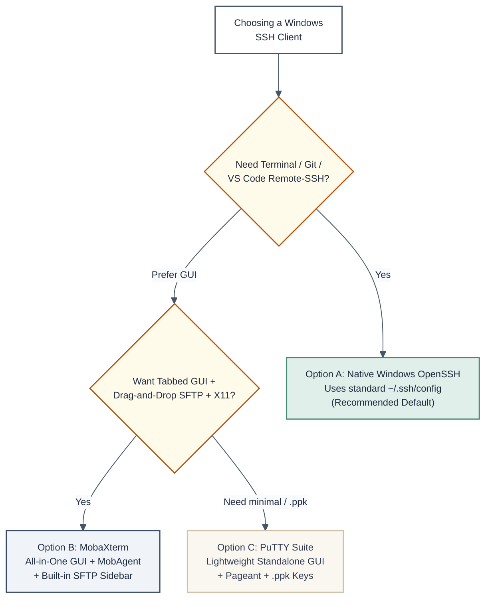

# 3. Windows SSH Clients

**Guide 3 of 5** · [← Client Configuration (macOS & Linux)](./02-client-configuration.md) · [Home](./index.md) · [Next: Advanced SSH Techniques →](./04-advanced-ssh.md)

---

Windows users have three primary ways to work with SSH. Use the decision chart and comparison table below to pick the client that best fits your workflow:



| Client | Best For | Config Format | Built-in SFTP / X11 |
|--------|----------|---------------|---------------------|
| **Native Windows OpenSSH** *(Recommended)* | Developers, PowerShell/Windows Terminal, VS Code Remote-SSH, Git | Standard `~/.ssh/config` | CLI (`sftp`, `scp`) |
| **MobaXterm** | All-in-one GUI: tabbed sessions, drag-and-drop SFTP sidebar, X11 forwarding, RDP/VNC | GUI Sessions + `~/.ssh/config` | Yes (built-in) |
| **PuTTY / Pageant / Plink** | Lightweight standalone GUI, legacy environments, `.ppk` key workflows | PuTTY Saved Sessions | Separate (`pscp`/`psftp`) |

---

## Option A: Native Windows OpenSSH (Recommended)

Windows 10 (1809+) and Windows 11 ship with the official **OpenSSH Client** built in. It uses the exact same commands and `config` syntax as macOS and Linux.

### 1. Verify (or Install) OpenSSH Client

Open **PowerShell** or **Windows Terminal** and run:

```powershell
ssh -V
```

If `ssh` is not found, open an **Administrator PowerShell** and install it:

```powershell
Add-WindowsCapability -Online -Name OpenSSH.Client~~~~0.0.1.0
```

### 2. Generate an Ed25519 Key

```powershell
ssh-keygen -t ed25519 -C "your_email@example.com"
```

Keys are saved to `C:\Users\<YourUser>\.ssh\id_ed25519` (private) and `id_ed25519.pub` (public).

### 3. Enable the Windows `ssh-agent` Service

By default, the Windows `ssh-agent` service is disabled. Enable it once in an **Administrator PowerShell**:

```powershell
Set-Service -Name ssh-agent -StartupType Automatic
Start-Service ssh-agent
```

Now add your private key (in a normal PowerShell window):

```powershell
ssh-add $env:USERPROFILE\.ssh\id_ed25519
```

> [!NOTE]
> Windows stores the key in the `ssh-agent` service persistently across reboots — you only need to run `ssh-add` once per key.

### 4. Configure `%USERPROFILE%\.ssh\config`

Create or edit `C:\Users\<YourUser>\.ssh\config` (e.g., `notepad $env:USERPROFILE\.ssh\config`):

```sshconfig
Host bastion
    HostName bastion.example.com
    User <username>
    IdentityFile ~/.ssh/id_ed25519

Host dev-app
    HostName 10.0.10.42
    User <username>
    IdentityFile ~/.ssh/id_ed25519
    ProxyJump bastion

Host *
    IdentitiesOnly yes
    ServerAliveInterval 60
    ServerAliveCountMax 3
```

Connect from PowerShell or Windows Terminal:

```powershell
ssh dev-app
```

---

## Option B: MobaXterm

**MobaXterm** is a feature-rich enhanced terminal for Windows that bundles an SSH client, a graphical SFTP file browser, an X11 server, and a built-in SSH agent (**MobAgent**).

### 1. Download & Install

1. Download **MobaXterm Home Edition** (Installer or Portable) from [mobaxterm.mobatek.net](https://mobaxterm.mobatek.net/download.html).
2. Run the installer (or extract the portable `.zip`).

### 2. Generate or Import an SSH Key

MobaXterm supports standard OpenSSH keys (`id_ed25519`) as well as PuTTY `.ppk` keys.

- **Using MobaKeyGen (GUI):**
  1. Go to **Tools → MobaKeyGen (SSH key generator)**.
  2. Select **EdDSA / Ed25519** (or **RSA** for legacy servers) and click **Generate**.
  3. Add a **Key passphrase**.
  4. Copy the public key text from the top box (to paste into `~/.ssh/authorized_keys` on your server).
  5. Click **Save private key** (`.ppk`) or **Conversions → Export OpenSSH key**.
- **Using an existing OpenSSH key:** You can point MobaXterm directly to `C:\Users\<YourUser>\.ssh\id_ed25519`.

### 3. Enable MobAgent (Built-in Key Agent)

So you only enter your passphrase once per Windows session:

1. Go to **Settings → Configuration → SSH**.
2. Check **Use internal SSH agent "MobAgent"** (or **Use external Pageant** if you already use PuTTY's Pageant).
3. Click the **`+`** button under *Load following keys in MobAgent* and select your private key.
4. Click **OK** and restart MobaXterm when prompted.

### 4. Create an SSH Session (with Optional Jump Host / SSH Gateway)

1. Click **Session** (top-left) and choose **SSH**.
2. Under **Basic SSH settings**:
   - **Remote host:** Enter your destination server (e.g., `10.0.10.42` or `dev.internal.example.com`).
   - Check **Specify username** and enter `<username>`.
   - **Port:** `22` (or your custom port).
3. Under **Advanced SSH settings**:
   - Check **Use private key** and browse to your private key (optional if loaded in MobAgent).
   - **X11-Forwarding** is enabled by default for launching remote GUI apps.
4. **To configure a Jump Host (Bastion):**
   - Switch to the **Network settings** tab.
   - Click **SSH gateway (jump host)**.
   - Enter the **Gateway host** (e.g., `bastion.example.com`), **Username**, **Port** (`22`), and select your **SSH key** (or check *Use MobAgent*).
   - Click **OK**.
5. Click **OK** to save and launch the session.

### 5. Bonus MobaXterm Features

- **Automatic SFTP Sidebar:** When connected over SSH, MobaXterm automatically opens a graphical SFTP browser on the left panel for drag-and-drop file transfers.
- **Local Terminal with OpenSSH:** Click **Start local terminal** to use standard `ssh`, `scp`, and `rsync` commands directly in a Bash-like shell.

> [!TIP]
> If you already maintain a standard `~/.ssh/config`, MobaXterm's **Local Terminal** can use it directly — giving you both GUI sessions and CLI aliases in one app.

---

## Option C: PuTTY, PuTTYgen & Pageant

**PuTTY** is a classic, lightweight Windows SSH client. Use it if you prefer a minimal standalone GUI or work in environments standardized on `.ppk` keys.

### 1. Download & Install PuTTY

1. Download the official **64-bit x86 MSI installer** from [putty.org](https://www.putty.org/).
2. Run the installer with the default options — this installs **PuTTY**, **PuTTYgen**, **Pageant**, and **Plink**.

### 2. Generate an SSH Key with PuTTYgen

1. Open **PuTTYgen**.
2. Under **Type of key to generate**, select **EdDSA** (with **Ed25519 (255 bits)**) — or **RSA** (`4096` bits) for legacy systems.
3. Click **Generate** and move your mouse randomly in the blank area until the progress bar completes.
4. Enter a strong **Key passphrase** and confirm it.
5. Copy the text in **Public key for pasting into OpenSSH authorized_keys file** — this is what you add to remote servers or GitHub.
6. Click **Save private key** (e.g., `C:\Users\<YourUser>\.ssh\my_key.ppk`).
7. Close PuTTYgen.

> [!TIP]
> Already have an OpenSSH private key (`id_ed25519`)? In PuTTYgen, click **Conversions → Import key**, select your OpenSSH key, and click **Save private key** to create a `.ppk` copy.

### 3. Load Your Key into Pageant (PuTTY Key Agent)

1. Launch **Pageant** from the Start Menu (it runs in the Windows system tray near the clock).
2. Double-click the Pageant icon in the system tray.
3. Click **Add Key**, select your `.ppk` private key, and enter your passphrase.
4. Click **Close** (Pageant stays running in the background).

#### Optional: Auto-Start Pageant on Windows Login

1. Press `Win + R`, type `shell:startup`, and press **Enter** to open your user Startup folder.
2. In another Explorer window, navigate to `C:\Program Files\PuTTY\`.
3. Right-click `pageant.exe` → **Create shortcut** (if prompted, place it on your Desktop, then move it into the Startup folder).
4. Right-click the new **Pageant** shortcut → **Properties**.
5. In the **Target** field, append the full path to your `.ppk` file in quotes:
   ```text
   "C:\Program Files\PuTTY\pageant.exe" "C:\Users\<YourUser>\.ssh\my_key.ppk"
   ```
6. Click **Apply** and **OK**.

### 4. Configure a PuTTY Session with a Jump Host (ProxyJump)

#### Modern Method (PuTTY 0.77+ — Native SSH Proxy)

1. Open **PuTTY**.
2. In **Session**:
   - **Host Name:** `<username>@10.0.10.42` (your final destination server).
   - **Port:** `22`.
   - **Saved Sessions:** Give it a name (e.g., `dev-app`).
3. In the left tree, navigate to **Connection → Proxy**:
   - **Proxy type:** Select **SSH to proxy and use port forwarding**.
   - **Proxy hostname:** `bastion.example.com`.
   - **Port:** `22`.
   - **Username:** `<username>`.
4. Return to **Session** in the left tree and click **Save**.
5. Click **Open** to connect.

#### Legacy Method (Older PuTTY Versions — Local `plink.exe` Proxy)

If you are using an older PuTTY release without native SSH proxy support:

1. Under **Connection → Proxy**, select **Local** as the Proxy type.
2. Set **Proxy hostname** to `bastion.example.com` and **Port** to `22`.
3. Set **Telnet command, or local proxy command** to:
   ```text
   "C:\Program Files\PuTTY\plink.exe" <username>@%proxyhost -nc %host:%port
   ```
4. Return to **Session**, click **Save**, and click **Open**.

---

**Guide 3 of 5** · [← Client Configuration (macOS & Linux)](./02-client-configuration.md) · [Home](./index.md) · [Next: Advanced SSH Techniques →](./04-advanced-ssh.md)
