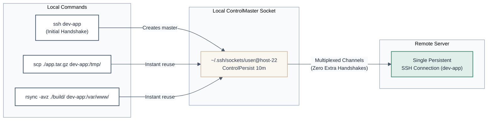
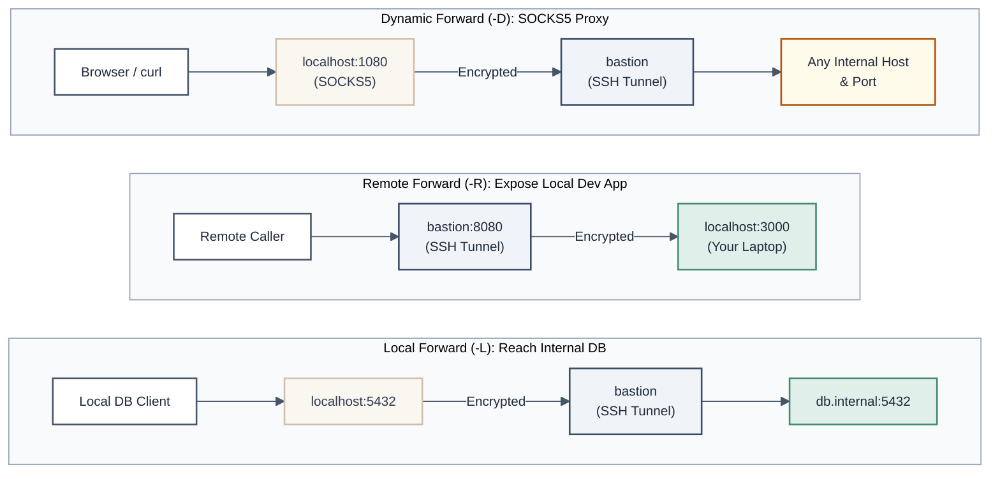

# 4. Advanced SSH Techniques

**Guide 4 of 5** · [← Windows SSH Clients](./03-windows-clients.md) · [Home](./index.md) · [Next: Troubleshooting & Cheat Sheet →](./05-troubleshooting-and-cheatsheet.md)

---

## 1. Connection Multiplexing (Instant Reconnects)

Opening a new SSH connection normally requires a full TCP + SSH handshake every time. **Multiplexing** reuses a single background master connection for all subsequent `ssh`, `scp`, `sftp`, and `rsync` calls to the same host — making them nearly instantaneous.



Add this to `~/.ssh/config` (macOS & Linux):

```sshconfig
Host *
    ControlMaster auto
    ControlPath ~/.ssh/sockets/%r@%h-%p
    ControlPersist 10m
```

Create the sockets directory first:

```bash
mkdir -p ~/.ssh/sockets
chmod 700 ~/.ssh/sockets
```

- `ControlMaster auto`: Creates a master connection if none exists, or reuses an existing one.
- `ControlPath`: Socket file location (`%r` = remote user, `%h` = host, `%p` = port).
- `ControlPersist 10m`: Keeps the master connection open in the background for 10 minutes after your last session closes.

To manually check or close a master connection:

```bash
ssh -O check dev-app
ssh -O exit dev-app
```

> [!NOTE]
> Connection multiplexing relies on UNIX domain sockets and is supported on **macOS and Linux** (and WSL on Windows), not in native Win32 OpenSSH.

---

## 2. Port Forwarding & Tunneling

SSH can securely tunnel TCP traffic between your local machine and remote networks.



### Local Port Forwarding (`-L`)

Access a service on a remote/internal network (such as a database or internal web UI) from your local machine:

```bash
# Syntax: ssh -L <local_port>:<target_host>:<target_port> <ssh_host>
ssh -L 5432:db.internal.example.com:5432 bastion
```

Now connecting your local DB client to `localhost:5432` securely tunnels through `bastion` to `db.internal.example.com:5432`.

### Remote Port Forwarding (`-R`)

Expose a service running on your **local** machine to a **remote** server (useful for testing webhooks or demos):

```bash
# Syntax: ssh -R <remote_port>:<local_host>:<local_port> <ssh_host>
ssh -R 8080:localhost:3000 bastion
```

Traffic hitting port `8080` on `bastion` is forwarded to `localhost:3000` on your laptop.

### Dynamic Port Forwarding / SOCKS5 Proxy (`-D`)

Turn an SSH server into an encrypted SOCKS5 proxy for your browser or CLI tools:

```bash
ssh -D 1080 -f -N bastion
```

Configure your browser or `curl --socks5-hostname localhost:1080 https://internal.example.com` to route traffic through `bastion`.

> [!TIP]
> **Useful Tunnel Flags:**
> - `-N`: Do not execute a remote shell/command (just forward ports).
> - `-f`: Go to the background after authenticating.
> - `-L` / `-R` / `-D` can also be saved permanently in `~/.ssh/config` using `LocalForward`, `RemoteForward`, and `DynamicForward`.

---

## 3. Secure File Transfers (`scp` & `rsync`)

### `scp` (Quick Single Files or Directories)

```bash
# Copy local file to remote server (uses ~/.ssh/config aliases automatically)
scp ./app.tar.gz dev-app:/tmp/

# Copy directory recursively from remote server to local
scp -r dev-app:/var/log/nginx ./nginx-logs/

# Copy through a jump host without a config entry
scp -J <username>@bastion.example.com ./file.txt <username>@10.0.10.42:/tmp/
```

### `rsync` over SSH (Large Transfers, Resumable, Incremental)

`rsync` only transfers changed bytes, supports compression (`-z`), preserves permissions (`-a`), and shows progress:

```bash
rsync -avz --progress ./build/ dev-app:/var/www/app/
```

---

## 4. Modular Configs (`Include`) & Conditional Logic (`Match`)

### Splitting Large Configs with `Include`

Keep work, personal, and client configs separate by placing `Include` at the **top** of `~/.ssh/config`:

```sshconfig
Include ~/.ssh/config.d/*
```

Then organize files like:
- `~/.ssh/config.d/work.conf`
- `~/.ssh/config.d/personal.conf`
- `~/.ssh/config.d/cloud.conf`

### Conditional Rules with `Match`

`Match` lets you apply settings dynamically based on hostname, user, or even the output of a local command:

```sshconfig
# Only use ProxyJump when NOT already on the corporate VPN/network
Match host *.internal.example.com !exec "ping -c 1 -W 1 10.0.0.1 >/dev/null 2>&1"
    ProxyJump bastion
```

---

## 5. Security Hardening

### Hardware Security Keys (FIDO2 / YubiKey)

OpenSSH 8.2+ natively supports FIDO2 hardware keys (`ed25519-sk`). The private key material never leaves the physical USB key and requires a physical touch to authenticate:

```bash
ssh-keygen -t ed25519-sk -C "yubikey-work"
```

### Host Key Checking

> [!CAUTION]
> **Avoid `StrictHostKeyChecking no` in persistent configs** — it silently disables Man-in-the-Middle protection. Keep `StrictHostKeyChecking ask` (the default) or `yes` for production automation.

### SSH Certificates (Team Scale)

For large teams, instead of distributing `authorized_keys` to hundreds of servers, consider **SSH Certificate Authorities (CAs)** (e.g., HashiCorp Vault, Smallstep `step-ca`, or AWS/Teleport). Users receive short-lived signed certificates (e.g., valid for 8 hours), eliminating stale keys and manual offboarding.

---

## 6. Interactive Escape Sequences

If a remote session freezes or you need to add a port forward on the fly, type **`Enter`** followed by an escape sequence:

| Sequence | Action |
|----------|--------|
| `~.` | **Immediately terminate** a hung SSH session |
| `~C` | Open the interactive SSH command line (e.g., type `-L 8080:localhost:80` to add a port forward without reconnecting) |
| `~^Z` | Suspend the SSH session to the background (`fg` to resume) |
| `~?` | List all supported escape sequences |

---

**Guide 4 of 5** · [← Windows SSH Clients](./03-windows-clients.md) · [Home](./index.md) · [Next: Troubleshooting & Cheat Sheet →](./05-troubleshooting-and-cheatsheet.md)
