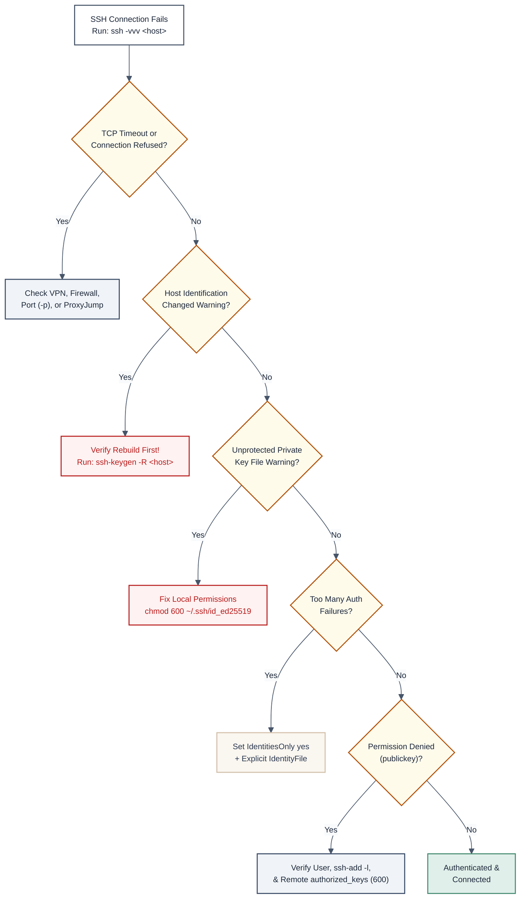

# 5. Troubleshooting & Cheat Sheet

**Guide 5 of 5** · [← Advanced SSH Techniques](./04-advanced-ssh.md) · [Home](./index.md)

---

## Debugging Connections (`-v`, `-vv`, `-vvv`)

When SSH fails, run the command with verbose output to see exactly which config file, key, and authentication method is being tried:

```bash
ssh -v dev-app      # Basic debug info (config matches, keys offered)
ssh -vvv dev-app    # Maximum verbosity (full handshake & packet details)
```

You can also inspect the **effective configuration** OpenSSH resolves for a host without actually connecting:

```bash
ssh -G dev-app
```

---

## Visual Troubleshooting Flow



---

## Common Errors & Fixes

### 1. `Permission denied (publickey)`
- **Wrong username:** Verify `User` in `~/.ssh/config` (e.g., `ubuntu`, `ec2-user`, `admin`, or your corporate username).
- **Wrong key offered:** Run `ssh -v <host>` and check `Offering public key:`. Ensure the matching `.pub` key is in `~/.ssh/authorized_keys` on the remote server.
- **Bad remote permissions:** On the remote server, ensure `~` is not group/world-writable, `~/.ssh` is `700`, and `~/.ssh/authorized_keys` is `600`.

### 2. `WARNING: UNPROTECTED PRIVATE KEY FILE!`
Your private key has permissions that are too open. Fix locally:
```bash
chmod 600 ~/.ssh/id_ed25519
```

### 3. `Too many authentication failures`
You have several keys loaded in `ssh-agent` and SSH tried too many of them before reaching the right one.
- **Fix:** Add `IdentitiesOnly yes` and an explicit `IdentityFile ~/.ssh/<key>` in `~/.ssh/config`, or run:
  ```bash
  ssh -o IdentitiesOnly=yes -i ~/.ssh/id_ed25519 <user>@<host>
  ```

### 4. `WARNING: REMOTE HOST IDENTIFICATION HAS CHANGED!`
The server's host key no longer matches `~/.ssh/known_hosts`. This commonly happens after rebuilding a VM or reusing an IP address.

> [!WARNING]
> Before clearing a stale host key, confirm with your infrastructure team or cloud console that the server was legitimately rebuilt and isn't a Man-in-the-Middle attack.

- **Fix:** Remove the stale entry cleanly with `ssh-keygen -R`:
  ```bash
  ssh-keygen -R <hostname-or-ip>
  ```

### 5. `Bad configuration option: usekeychain` (Linux)
You copied a macOS `~/.ssh/config` to Linux.
- **Fix:** Add `IgnoreUnknown UseKeychain` right above `UseKeychain yes`.

### 6. Windows: `unable to start ssh-agent service, error :1058`
The Windows `ssh-agent` service is disabled by default.
- **Fix:** Run in an **Administrator PowerShell**:
  ```powershell
  Set-Service -Name ssh-agent -StartupType Automatic
  Start-Service ssh-agent
  ```

---

## Quick Reference Cheat Sheet

### Essential Commands

| Task | Command |
|------|---------|
| Generate Ed25519 key | `ssh-keygen -t ed25519 -C "you@example.com"` |
| Copy public key to server | `ssh-copy-id -i ~/.ssh/id_ed25519.pub user@host` |
| Add key to agent (Linux/Win) | `ssh-add ~/.ssh/id_ed25519` |
| Add key to agent (macOS) | `ssh-add --apple-use-keychain ~/.ssh/id_ed25519` |
| List loaded agent keys | `ssh-add -l` |
| Connect via jump host | `ssh -J user@bastion user@internal-host` |
| Local port forward | `ssh -L 8080:target:80 -N bastion` |
| Dynamic SOCKS5 proxy | `ssh -D 1080 -f -N bastion` |
| Inspect resolved config | `ssh -G <host-alias>` |
| Remove stale known_hosts entry | `ssh-keygen -R <hostname-or-ip>` |
| Kill hung SSH session | `Enter` then `~.` |

### Key `~/.ssh/config` Directives

| Directive | Purpose |
|-----------|---------|
| `Host <alias>` | Pattern/alias matched on the CLI (`ssh <alias>`) |
| `HostName <addr>` | Actual DNS name or IP address |
| `User <name>` | Remote login username |
| `Port <num>` | SSH port (default `22`) |
| `IdentityFile <path>` | Path to the private key to use |
| `IdentitiesOnly yes` | Only offer explicitly configured keys |
| `ProxyJump <host>` | Route connection through one or more jump hosts |
| `AddKeysToAgent yes` | Automatically load key into `ssh-agent` on first use |
| `ServerAliveInterval 60` | Send keepalive every 60 seconds |
| `ControlMaster auto` | Enable connection multiplexing |
| `Include <glob>` | Load additional config files |

---

**Guide 5 of 5** · [← Advanced SSH Techniques](./04-advanced-ssh.md) · [Home](./index.md)
