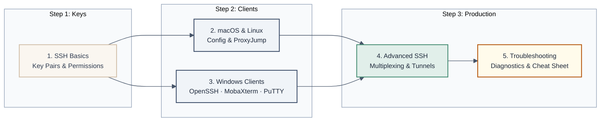

# SSH Learnings

Welcome to **SSH Learnings** — a comprehensive, cross-platform field guide to Secure Shell (SSH) for both beginners and experienced engineers.

> [!TIP]
> New to SSH? Start with **[1. SSH Basics](./01-ssh-basics.md)** and follow the progression below. Already comfortable with keys? Jump straight to **[ProxyJump](./02-client-configuration.md)**, **[Windows Clients](./03-windows-clients.md)**, or **[Advanced Tunneling](./04-advanced-ssh.md)**.

---

## Guide Roadmap

---

## Guides

| # | Guide | Focus |
|---|-------|-------|
| 1 | **[SSH Basics](./01-ssh-basics.md)** | Public-key authentication handshake, generating modern `ed25519` keys, `ssh-copy-id`, `ssh-agent`, and file permissions. |
| 2 | **[Client Configuration (macOS & Linux)](./02-client-configuration.md)** | `~/.ssh/config` evaluation order, cross-platform defaults, multiple identities, and single/multi-hop `ProxyJump` bastions. |
| 3 | **[Windows SSH Clients](./03-windows-clients.md)** | Decision flowchart + step-by-step setup for **Native Windows OpenSSH**, **MobaXterm**, and **PuTTY / PuTTYgen / Pageant**. |
| 4 | **[Advanced SSH Techniques](./04-advanced-ssh.md)** | Connection multiplexing (`ControlMaster`), Local/Remote/SOCKS5 port forwarding, `scp`/`rsync`, `Include`/`Match`, FIDO2 keys, and escape sequences. |
| 5 | **[Troubleshooting & Cheat Sheet](./05-troubleshooting-and-cheatsheet.md)** | Diagnostic flowchart with `ssh -vvv` and `ssh -G`, common error fixes, and copy-pasteable reference tables. |
